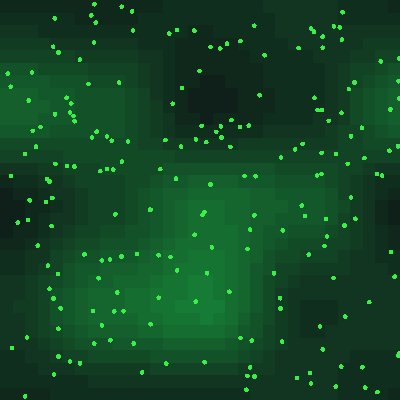
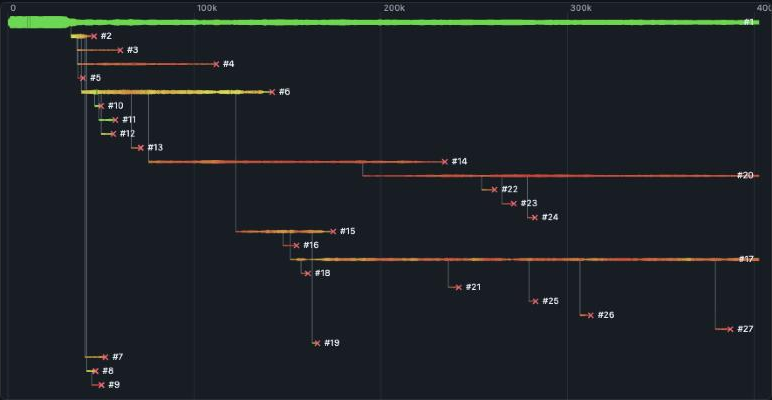
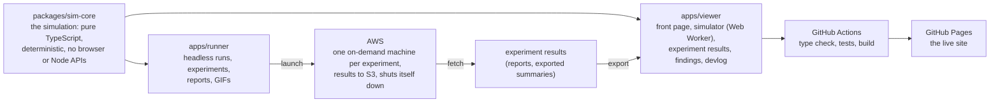

# Evolution Sim

A browser-based artificial-life simulation where simple organisms evolve in a dynamic, changing world.

Nobody is told to be a predator, a plant eater or a scavenger. Those roles, along with arms races, new species and colonies of cells, **emerge** from random mutation plus one universal rule: everything costs energy.

**Live:** https://ge0ffr3y.github.io/evolution-sim/
- [the simulator](https://ge0ffr3y.github.io/evolution-sim/app.html);
- [what we found](https://ge0ffr3y.github.io/evolution-sim/read.html?doc=findings);
- [the devlog](https://ge0ffr3y.github.io/evolution-sim/read.html?doc=devlog);
- [experiment results](https://ge0ffr3y.github.io/evolution-sim/analysis.html).



*Seed 12 over 60,000 ticks. Everyone starts as a green, unarmed plant eater. The first kill happens at tick 60, the first scavenger at 566, and by tick 8,690 a lineage lives mostly on meat (red). Larger dots are larger bodies.*

## What emerges

Nothing below is programmed in. There is no predator class; whether eating others pays depends on an organism's genes and its surroundings. Details and charts: [What we found](docs/findings/README.md).

- **Food webs.** In the simple world a lineage that lives mostly on meat appears in 12 of 12 worlds, then plant eaters and meat eaters settle into irregular waves.
- **Arms races.** Prey answer with armor and speed.
- **Species.** 23 to 50 species over a million ticks, with three or four alive at a time.
- **A changing world leaves its mark.** Water splits populations that then drift apart nine times as far. An ice age halves the population and leaves cold-loving survivors.
- **Brains.** Prey learn to turn away from threats, and hunters learn to ambush. They never learned to chase.
- **Colonies.** Colonies of specialized cells beat single cells in a sunlit, low-food world.
- **Experiments at scale.** Thousands of worlds run in the cloud, compared seed by seed.
  - Sex blends would-be meat eaters back into the plant eaters.
  - Barriers raise diversity.
  - Poorer plant food lengthens the food chain.
- **The meat-eater puzzle.** In the full "grand world", four features together (seasons, harmful mutations, sex and kin restraint) erase lasting meat eaters, because each hurts a small group most. It is reported as an open problem, with an autopsy of what kills them.
- **Living plants.** Plants evolve to fit their land, and poisonous plants are selected beyond chance.



## How it works

- **Genes**, each 0 to 1, for size, speed, senses, metabolism, diet, attack, armor and more (up to 33 with every optional feature). Every trait costs energy every tick, so no trait is free.
- **Two ledgers, both checked by tests.**
  - Energy flows one way (sun, plants, eaters, heat) and balances to better than one part in a billion.
  - Matter goes round in a circle (soil, plants, bodies, corpses, detritus, soil) and is never created or destroyed.
- **Predation is physics.** An armed organism attacks the nearest prey in reach, with odds from attack and size against armor and size. A kill leaves a corpse that anyone with a meat appetite can eat.
- **Optional layers.** All are off unless a preset switches them on:
  - evolvable neural-network brains;
  - terrain, climate, seasons and disasters;
  - aging, disease, camouflage and kin recognition;
  - sex;
  - colonies of specialized cells;
  - living plants.
- **Determinism.** The same seed and settings give the same history in any browser, on a laptop or in the cloud. All randomness comes from one seeded generator, and the simulation avoids math functions whose rounding differs between browsers.

### Architecture



## Design principles

1. Emergence over hard-coding. There is no `Predator` class.
2. Energy is the universal currency, so every trait has a cost.
3. Eating is physics, not a role.
4. The nutrient loop is closed.
5. Determinism: the same seed and settings always give the same history.
6. Observability first: charts, family trees and an inspector for any organism.
7. Evidence over anecdote: claims rest on many seeds compared side by side, and open problems are reported as open.

## Watch a world

| World | What to watch for |
|---|---|
| [The grand world](https://ge0ffr3y.github.io/evolution-sim/app.html?seed=42&preset=grand-world) (the default) | Every feature at once. Species branch on the family tree, and a second feeding level of mixed eaters takes hold. |
| [Food webs from nothing](https://ge0ffr3y.github.io/evolution-sim/app.html?seed=12&preset=default) | The first kill within a few hundred ticks, then a lineage that lives on meat. |
| [Predator arms race](https://ge0ffr3y.github.io/evolution-sim/app.html?seed=42&preset=arms-race) | Cheap fighting: killing at once, armor and speed climbing. |
| [Ice age](https://ge0ffr3y.github.io/evolution-sim/app.html?seed=42&preset=ice-age) | At tick 60,000 the world cools: the population halves, and the survivors like it colder. |
| [Two continents](https://ge0ffr3y.github.io/evolution-sim/app.html?seed=12&preset=two-continents) | Each half grows its own species. |
| [Living plants](https://ge0ffr3y.github.io/evolution-sim/app.html?seed=7&preset=grand-living-plants) | Plants evolve to fit their land: compare the Plant warmth and Temperature overlays. |

There are 46 presets in all, in [`configs/`](configs) and in the viewer's World menu.

**Sharing a run.** The address holds everything needed to replay a run exactly, and the **Copy link** button copies it:
- `seed` and `preset` pick the world;
- `set` changes any setting on top of the preset, for example `?seed=5&preset=grand-world&set=plantEvolution:1,plantToxins:1`.

In the simulator:
- click any organism to inspect its genes, energy, family and (with brains) its brain thinking;
- color the dots by diet, size, palate and more, and switch the map between plants, terrain, temperature and other overlays;
- scroll down for the charts, the family tree and the timeline;
- **Save world** and **Load world** store a run in a file and bring it back exactly.

## Getting started

Requires Node.js 20 or newer.

```bash
npm install
npm test            # all tests (they also run on GitHub for every push)
npm run typecheck   # type-check every workspace
npm run dev         # the site at http://localhost:5173 (front page; the simulator is app.html)
npm run sim -- --seed 42 --ticks 100000     # one headless run: CSV of stats and trait histograms
npm run sim -- --seeds 1-12 --ticks 100000  # many seeds in parallel, then a summary
npm run sim -- --config configs/grand-world.json --seed 3 --set plantEvolution=1   # a preset world, with a change
npm run gif -- --seed 12 --ticks 60000      # a time-lapse GIF (no browser needed)
npm run bench       # how fast is the simulation?
```

### Experiments

An experiment is a short JSON file in `experiments/<name>/`:
- the base world;
- the setups ("arms") to compare;
- the seeds, the length and the measures.

```bash
npm run exp -- check experiments/<name>      # is the file sound?
npm run exp -- estimate experiments/<name>   # how long and how much
npm run exp -- run experiments/<name>        # run it here (saves progress and resumes)
npm run exp -- report experiments/<name>     # compare every arm with the control: report.md, red flags first
npm run exp -- export experiments/<name>     # the summary the Experiment results page reads
```

Big experiments run on one on-demand AWS machine:

```bash
npm run exp -- cloud launch experiments/<name> --confirm --max-cost <dollars>
```

Nothing starts without an approved cost ceiling, and the machine shuts itself down. See [`infra/aws/README.md`](infra/aws/README.md).

## Repo layout

| Path | What it is |
|---|---|
| `packages/sim-core` | The simulation: pure TypeScript, no UI, no browser or Node APIs |
| `apps/viewer` | The site: front page, simulator, experiment results, findings and devlog pages |
| `apps/runner` | Node CLI: headless runs, seed sweeps, experiments (laptop and cloud), reports, GIFs; analysis scripts in `scripts/` |
| `configs/` | Preset worlds (JSON) |
| `experiments/` | Experiment files and their reports (raw results are not kept in git) |
| `docs/findings` | What we found ([start here](docs/findings/README.md)) and the working notes behind it |
| `docs/devlog` | One entry per phase ([index](docs/devlog/README.md)) |
| `docs/plans` | Plans written before each piece of work |
| `infra/aws` | How the cloud runner is set up |
| `tests/` | Repo-wide guardrail tests (for example, no browser-dependent math in the simulation) |

## Roadmap

| # | Phase | Outcome |
|---|---|---|
| 0 | Foundations | Repo, tooling, live placeholder page |
| 1 | Minimal living world | Organisms eat, reproduce, mutate, die |
| 2 | Genome and trade-offs | Real energy economics, diverging traits |
| 3 | Food webs | Emergent predators, nutrient loop (**v0.1**) |
| 4 | Senses and brains | Prey flee and hunters ambush (chasing did not evolve) |
| 5 | Species and phylogeny | Species tracking, family tree, sexual reproduction, save and load (**v0.2**) |
| 6 | Dynamic world | Terrain, climate, seasons, catastrophes |
| 7 | Ecological depth | Aging, litter size, kin, disease, camouflage (**v0.3**) |
| 8 | Multicellularity | Colonies, cell types, body plans (**v0.4**); then the grand world (8b to 8f) |
| 9 | Experiments at scale | Cloud runner, audit of the grand world, headline experiments, the meat-eater hunt, living plants |
| 10 | Ship it | Front page, shareable links, findings and devlog on the site, this README (**v1.0**) |

## License

MIT, see [LICENSE](LICENSE).
