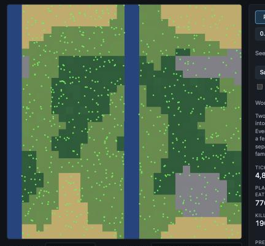

# Devlog 6: A dynamic world

*Phase 6. The world stops being a lawn. It gets coasts, climate, seasons and disasters, and populations that cannot reach each other drift apart.*

*The Two continents preset on the Terrain map layer. Nothing can cross the blue channels.*

## What was built

Everything here is off in the standard world, so every earlier world plays out exactly as before (the golden fingerprints did not change).

- **Terrain.** Smooth noise makes water, plains, forest, desert and mountains. Water is a hard barrier: nothing can enter it and plants do not grow there, so an organism that reaches a shore stops and turns around. Forests grow plants 1.3 times as fast, deserts 0.3, mountains 0.4, and moving through forest, desert and mountains costs 1.4, 1.2 and 3 times as much. Founders and babies always start on land. Two straight water channels can cut the world into two continents. The map of a given seed is the same whatever else is switched on.
- **Climate.** Every cell has a temperature: warmest in the middle of the map, colder toward the top and bottom edges (the world wraps around, so both edges are "poles"), colder on mountains. Plants grow best at a moderate temperature, in proportion to sunlight. Optional parts: day and night, seasons (a year of any length, with a bigger swing toward the edges), and a slow warming and cooling of the whole world. The sun is still the only energy that enters the world and the energy ledger still balances.
- **A temperature-preference gene (the 11th).** Being more than a tolerance away from the preferred temperature costs extra upkeep (counted in the basal line of the ledger). The gene does nothing unless a climate and a thermal cost are switched on.
- **Catastrophes.** An ice age (the whole world colder, building up and fading over a set time), a drought (plant growth collapses and recovers), or a meteor strike (everything in a circle dies, the bodies become corpses and the plants there are destroyed: their matter becomes detritus and their energy is lost as heat, so conservation still holds exactly). They happen at a scheduled tick, at random, or both.
- **Viewer:** map layers for Terrain, Temperature and Plant growth, a season and time-of-day readout, and catastrophes in the timeline. Water is always drawn as water.
- **Presets:** Continents and seas, Two continents, Seasons, Climate and continents, Slow climate change, Climate adaptation, Ice age, Meteor strike, Random catastrophes.
- **Tests:** 340 pass. Each feature has tests for its mechanics, determinism, energy and matter conservation (to better than one part in a billion), and saving and reloading a world in the middle of it. A guard test fails if something is added to the world and neither saved nor listed as scratch space.

## What emerged

- **Barriers split species.** 300,000 ticks, 8 worlds each, the same land with and without two water channels. Without the channels the two halves of the world stay alike (average genetic difference 0.024, and nearly every species, 2.9 of them, lives on both sides). With them the halves drift apart by 0.216, nine times as much (0.117 to 0.417 across worlds), and nearly all species (3.1 of them) live on one side only. Each continent grows its own set of species. A side effect: the divided worlds held about 520 organisms against 300, because prey on one continent get a refuge from predators on the other.
- **An ice age changes who survives.** 8 worlds, with a 20,000-tick ice age (0.3 colder at the worst) starting at tick 100,000, each compared with the same world without one (they are identical until the ice age starts). At the worst of it the population fell by about half in all 8 worlds (for example 525 to 242, against 513 for the world without an ice age), and 1 to 2 species went extinct in 7 of 8. The survivors differed in a consistent direction in 8 of 8 worlds: a lower preferred temperature (16% lower on average), smaller bodies (22% smaller), and much less meat eating (the average diet value fell by half). Populations recovered within 20,000 ticks, usually past where the unaffected world was.
- **The population follows the seasons.** With a year of 2,000 ticks, the population's power at the period of the year was 13 to 78 times its power at other periods (6 worlds), and it swung by about 40% of its average each year. Without seasons the ratio was 0.1 to 0.9, which is noise.
- **Selection sorts the world by latitude.** In a test world, survivors in the cold bands prefer the cold and survivors near the equator prefer the warm after only 500 ticks, because mismatched animals pay more and die first.

## What broke, or only partly worked

- **Sex and barriers: weaker than without sex.** With sexual reproduction, two continents drift apart by only 0.03 against 0.006 without a barrier (3 worlds that could be measured), still far below the 0.2 of asexual worlds, and no new species appeared in 300,000 ticks (single plant-eater species as in Phase 5). In 3 of 6 sexual worlds with a barrier, one continent ended up with fewer than 5 organisms in every sample: a population on one side never got going or died out.
- **A first version of the crash detector logged every winter.** In a seasonal world the population swings by more than 40% each year, which tripped the "population crash" alarm annually. It now judges the population averaged over a whole year, so a real collapse is logged about half a year after it starts.
- **Brains cannot see water or temperature.** Organisms with brains bump along coasts and cannot steer toward comfort. A "barrier ahead" and a "temperature comfort" sense are the obvious next additions; I held off because they change the brain layout and every brain-world golden result.
- **Temperature preference evolves slowly.** In a normal world with ordinary mutation, the preferred temperature moved only about 0.02 in 24,000 ticks, so adaptation shows up over hundreds of thousands of ticks (the ice age experiment relies on the variation that has built up by tick 100,000).
- **Only one catastrophe is active at a time**, meteors are instantaneous, and an ice age cools every cell equally.
- **Left unticked or not done:** none of Phase 6's boxes. Phase 6 has no public release in the roadmap (the next is v0.3 in Phase 7).

## Next

Phase 7, ecological depth: aging, life strategies, disease, signals and camouflage, kin recognition and herding. Kin recognition would address the plant-eaters-killing-each-other collapse from the sexual worlds in Phase 5, and a visible marker could let organisms choose mates (the color gene is waiting for a job). Carried over: the parked chase question from Phase 4, brain senses for water and temperature, and lifestyle clustering across species.
