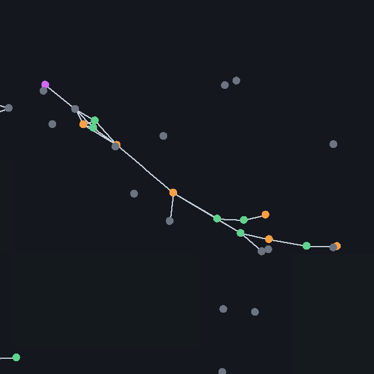

# Devlog 8: From cells to bodies

*Phase 8. Cells can stay together, share food, specialize and bond with strangers. A multicellular lineage does arise and does beat single cells, but only in a narrow niche, and mostly when we give it a head start.*

*The largest colony (16 cells, the cap) in the Symbiosis preset, seed 9, tick 300,000, colored by cell type. Lines are bonds. Plants are shown faintly. It is one long chain with feeders, photosynthesizers, a sensor and generalists; the loose gray dots are single cells.*

## What was built

Everything is a switch, off in the standard world, so every earlier world plays out exactly as before (the brains-off golden fingerprints did not change). Multicellularity needs brains off (a colony's cells cannot yet be steered by separate brains).

- **A cell is an organism.** There is no new "colony" object. A colony is just a group of ordinary organisms joined by bonds, so every rule about energy, matter, death and reproduction still applies to each cell.
- **A bonding gene (14th gene).** The chance that a newborn stays attached to its parent. A bonded baby is placed right next to the parent, and each cell can hold up to four bonds (a colony tops out at 16 cells, both set in the config).
- **Colony physics.** Bonds are springs that pull cells toward a resting distance, bonded cells steer toward the same heading so the colony moves together, and cells share energy with their bonded neighbors (a tenth of the difference per tick). Sharing moves energy between cells and never creates any, so the energy ledger balances.
- **Six cell types.** Generalist (the ordinary cell), feeder (bigger bites, slower), mover (faster, smaller bites), photosynthesizer (collects sunlight directly, which is added to the ledger as sun coming in), armor (tough, costs more upkeep) and sensor (sees far, bites less). Each has a cost and a benefit set in the config.
- **A body-plan genome (genes 15 to 17).** Three genes say which cell type a baby becomes, depending on which bond slot of its parent it grew from, so a lineage's genes describe the shape of its body.
- **Division of labor.** Specialist cells are sterile (only generalists reproduce) and live on shared energy from their neighbors. A specialist that loses all its bonds goes back to being a generalist, so a specialist only makes sense as part of a body.
- **Colony defense.** A cell is harder to kill when its bonded neighbors have armor.
- **Cross-lineage bonding (symbiosis, optional).** Instead of only bonding with their own babies, cells can bond with any cell they touch, with a stickiness gene (18th) deciding how readily. Nothing rewards it: bonded cells just share energy, so a mixed colony can help both partners or let one drain the other, and selection decides. We chose this over a built-in mutualism bonus because a bonus would put a thumb on the scale.
- **Complexity metrics.** Colonies, cells in colonies, mean and largest colony, average number of cell types per colony, and a mirror-symmetry score (how well a colony matches its own reflection), tracked over time and charted in the viewer. The runner writes them to its CSV.
- **Viewer:** bond lines, Colony size and Cell type color modes, a colonies readout, a complexity chart.
- **Presets:** Colonies, Sunlit colonies (the niche where it pays) and Symbiosis.
- **Tests:** 432 pass, including determinism, energy and matter conservation with bonds, bond bookkeeping when cells die or are shuffled, save and reload, and a check that sterile specialists really do not reproduce.

## What emerged

The experiments used a "sunlit" niche: plants regrow at 0.012 per tick (the standard rate is 0.08, so food is scarce) and photosynthesis gives 0.07. 12 paired seeds per arm, 500,000 ticks.

| Arm | Worlds with a lasting multicellular lineage | Mean final population |
|---|---|---|
| Single cells (control) | 0 of 12 | 331 |
| Bonding only, no cell types | 0 of 12 | 301 |
| Bonding and cell types, bonding gene at 0 to start | 1 of 12 | 339 |
| **Bonding and cell types, a third of the first babies bond** | **7 of 12** | **628** |
| Symbiosis preset (contact bonding, bonding gene at 0 to start) | 2 of 12 | 412 |

"Lasting" means the bonding gene is still above 0.1 and at least a tenth of all cells are in colonies at the end.

- **A multicellular lineage can outcompete single cells.** Where it was seeded, 5 worlds ended with 79 to 90% of all cells in colonies. By final population the colony world beat its matching single-cell world in 8 of 12 seeds, tied in 1 and lost in 3, and the average population nearly doubled (628 against 331). Colonies were small (largest 5 cells), with about 2 to 2.5 cell types each and a symmetry score of 0.5 to 0.8.
- **The biggest colonies came from nothing.** In the symbiosis run, seeds 9 and 10 started with no bonding at all, and the bonding gene rose by mutation until colonies of up to 16 cells (the cap) held 78% of the cells in seed 9 (1,193 of 1,533 at tick 500,000; at tick 300,000 there were 148 colonies averaging 3.8 cells and 2.9 cell types, with a symmetry score of 0.53), and the population was nearly six times its control (1,533 against 261).
- **Why colonies fail in the other worlds: predators.** I checked the 12 colony worlds at tick 200,000. In the five where colonies were kept (and seed 12), there were 0 meat eaters at that point (seed 12 had 44 and kept colonies anyway). In all six where bonding was lost, 11 to 44 meat eaters had appeared and 83,000 to 170,000 kills had happened. Colonies pay by making a living from sunlight in a food-poor world without hunters. Once hunters evolve, cheap single cells that spread out do better.
- **Complexity trends up, modestly, in about four worlds.** In seeds 3, 7 and 9 the average colony grew from 2.4 to about 3.0 cells, and the number of cell types rose in seeds 3, 5, 7 and 9. In the rest, bonding was lost before there was anything to grow, which is the predator story above.
- **In the standard world colonies do not persist** (about 3% of cells, whether or not they start with a head start). My reading is that with plentiful food a colony has nothing to gain over loners, but I did not test that separately.

## What broke, or only partly worked

- **Bonding alone does not pay.** The first version, bonded cells that share energy and nothing else, lost in every world. Bonded cells clump onto the same patch of food and compete, and an experiment showed bonded pairs ending up with less energy than loners (an energy fraction of 0.24 against 0.54 for loners in my test). Colonies stayed at 2 cells. Cell types were not enough either until specialists were made sterile and made to revert when alone: a specialist that can still reproduce just competes with its own body.
- **Colonies rarely start from scratch.** With the bonding gene starting at 0, only 1 of 12 worlds in the full model and 2 of 12 in the symbiosis run built colonies. So "arises from single cells" is true but rare, and the 7 of 12 result depends on seeding a third of the first generation to bond. I would not call that a fully spontaneous result.
- **Symbiosis did not happen.** The stickiness gene started at 0.3 and fell to 0.03 on average, and in 12 of 12 worlds not one mixed-lineage colony existed at the end. Bonding with strangers has no payoff beyond what relatives give, and in a mixed colony one partner can drain the other, so selection removed it. The colonies in seeds 9 and 10 are all of one lineage, grown from babies. This is a real negative result, not a bug that I found, but I did not test other ways to make mutualism pay (for example cell types that only work in a mixed pair), because that would be a hard-coded bonus.
- **Brains and colonies do not mix.** Colonies need brains off. A colony that thinks with several brains is a later problem.
- **Colony size is capped at 16.** Seed 9 hit the cap, so we do not know how big it would get.
- **The Done-when items are partly met.** A multicellular lineage that outcompetes single cells exists (a sunlit, low-food niche with no predators; about two thirds of seeded worlds), but spontaneous origin is rare, and complexity metrics trend upward in about a third of worlds, with a clear explanation (predators) for most of the others.

## How to see it

- Load the **Sunlit colonies** preset (seed 3 is a good one), set the color mode to **Cell type**, run at Max speed and watch the colonies readout.
- Load **Symbiosis**, seed 9, and let it run past 300,000 ticks. Color by **Colony size**.
- The complexity chart (share in colonies, mean size, cell types, symmetry) sits under the population chart.

## Next

Phase 9, experiments at scale: parameter sweeps and findings with proper statistics. Phase 8 gave plenty to study: when does bonding pay (food level, photosynthesis, predators), and does a bigger colony cap let bodies keep growing. Carried over: the parked chase question from Phase 4, brains for colonies, and whether evolved brains use the Phase 7 senses.
