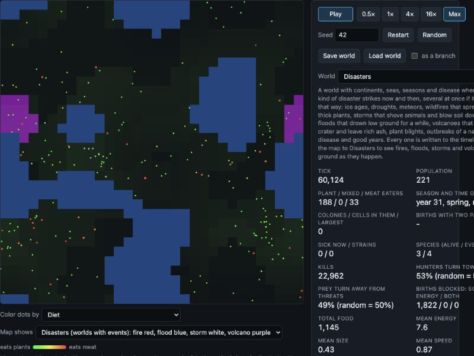

# Devlog 13: Ecology overhaul (Sonnet batch)

*Phase 8e, first half. The 5-million-tick run showed a world that was stable but dull: food gone bare in patches, nothing ever left a scar, nothing ever struck at random. This batch adds the things that make an ecosystem push back: a better births counter, three kinds of ground damage, poison and learned avoidance, and ten kinds of disaster. Everything is optional and off by default, so every older world is bit-for-bit unchanged. The second half (nutrients through food, water and moisture, colony physics, meat eating) is still to come.*

## What was built

- **S1. Brain chart colors.** The thinking-units chart now uses two clear colors and resizes with its panel.
- **S2. Births blocked, split in three.** Is a birth stopped by soil with too little nutrient, by the parent lacking energy, or both? In long grand-world runs it is almost always the **soil** (tens of thousands of blocked births, a handful from energy), growing steadily. Nutrient piles up in a few cells and starves the rest. An idea to mix soil nutrient is written up and parked for discussion (S2b).
- **S3 to S5. Ground that remembers.** Overgrazing (a cell eaten bare gets damaged and regrows slowly), fouling (crowded ground is fouled, judged against the average cell, slowing plants and spreading disease), and erosion (bare ground loses soil health, which slows regrowth and lowers the plant ceiling). Each has a map layer. Overgrazing and fouling cost the population 25 to 45% but barely moved the animals, because animals cannot sense damage. A "ground health" brain input is recommended for the next batch.
- **S6. Poison.** A toxicity gene: it costs upkeep, poisons whoever eats the body, and a hunter that is poisoned remembers the color of its meal and avoids it. It cuts predation sharply (meat eaters 108 down to 15 at the strongest) and it is a public good, so toxicity itself stays low. Distinct warning colors did **not** emerge, because the color gene is neutral and prey converge on almost one hue. Not switched on in the grand world.
- **S7. Disasters.** Ten kinds that can overlap, each drawing its strength, radius and length from a range: ice age, drought, meteor, wildfire, storm, flood, volcano, plant blight, disease outbreak and good year. They run on a random stream of their own, so switching them on never reshuffles anything else. Each says where destroyed things go: burnt plants become ash in the soil, drowned or crushed plants become detritus, dead animals become corpses, a storm moves soil but never destroys it. All ten firing at once, energy and matter still balance to a billionth.

## What emerged

Disasters, 6 worlds of the standard continent-and-seasons world with disease, 60,000 ticks, against the same world with disasters off:

| | Without disasters | With disasters |
|---|---|---|
| Worlds that survived | 6 of 6 | **4 of 6** |
| Mean population | 138 to 374 | 150 to 255 |

- **Volcano ash is a real and lasting boost:** burnt ground grew 1.35 to 1.9 times the plants of ordinary ground at 200, 2,000 and 8,000 ticks later.
- **Fire leaves no lasting boost.** Regrowing plants eat the ash within a few ticks, and fires start on the best-fed ground. Whether to give fire a small fast-fading ash bonus is left to the owner.
- Plant blights and droughts hurt most (population falls to 57 to 64% at the low point); storms and floods least. Recovery averages one to a few hundred ticks, up to about 900 for blight.
- In the 512 grand world, with all of the finished mechanics switched on at mild settings, 3 worlds ran 20,000 ticks without trouble (populations 225 to 850, books balanced to 1e-13, disasters fired in each).

## What broke, and how

- **Fire never spread** the first time. I judged how much fuel a cell held against its plant ceiling, but in the standard world most cells stand at 1 to 3% of capacity. Fuel is now judged against the average cell. This is the same lesson as fouling and erosion: absolute numbers do not travel between worlds.
- **The first ice age was a world-killer** (up to 0.4 colder for up to 6,000 ticks, in worlds with no temperature-adapted animals). Gentler defaults now.
- **A saved-world bug in poison:** a newborn reused an old animal's slot and kept its color memory, so a reloaded world drifted. Caught by a test; memory is cleared at birth.
- **My own experiment slips:** a sampling rule that never fired for a 1,000,000-tick run wasted about an hour, and I reported runs as unfinished that had finished. Every status is now verified before it is reported.

## Lessons

- **Relative beats absolute.** Compare a cell with the average cell, not with a number picked in one world.
- **Small worlds are fragile.** Disasters that are mild for thousands of animals can end a population of 150. Judge them in the grand world.
- **Keep the old thing running.** The old catastrophe settings were left untouched next to the new engine, and I could prove old worlds are identical.
