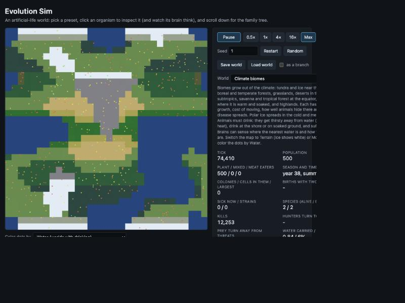

# Devlog 14: Nutrients, climate biomes and colonies

*Phase 8e, second half. Four bigger changes: nutrients that travel through food, climate biomes with water and ice, colony physics with shared senses, and a long hunt for why meat eating fails in the grand world. Everything is optional and off by default, so older worlds are unchanged. The first three work as designed; the fourth found its cause but not yet its cure.*

## Fixes found on the way

- **Disasters were too fierce.** A wildfire could relight ground it had just burned, so one fire circled the map nine times and emptied a world. Burnt ground now cannot burn again for a while (`evFireRecover`). Storm and volcano settings were also scaled down, and 6 of 6 grand worlds now survive.
- **An older energy leak:** colony sharing and food gifts could pour energy into a cell a disaster had just killed, where it vanished. Dead cells now take nothing.
- **Old saved worlds:** adding a gene or a brain input used to shift everything in a saved world silently. Saves now record their layout, and older ones are renumbered when they load.
- **CI timed out** on the heaviest new tests (2 seconds here, over 5 on GitHub's machines). They now get a longer limit.

## O1: nutrients through food

- Animals carry a nutrient store filled by eating: a little of plants, most of meat, because meat is already body. Some of the store is lost as dung wherever they walk. Babies are built from the parent's store, and a well-fed parent gives its baby a bigger start. An animal short of nutrient pays more upkeep.
- In mode 2, plants on poor soil are poor food.
- **What emerged:** nutrient became a real second resource. In the grand world 12 to 25% of animals are short of it. In the standard world, meat (rich in nutrient) became far more worth hunting, and meat eaters appeared in every world.
- **What didn't:** animals do not travel to richer ground, because they could not sense it. That led to the next item.

## O2: climate biomes, water and ice

- A new terrain mode grows nine biomes from temperature and moisture: tundra, boreal forest, grassland, temperate forest, desert, savanna, tropical forest, swamp and highlands. Each has its own growth, cost of moving, hiding and disease, with an upside and a downside.
- Polar and mountain ice spreads 3 to 4 times in an ice age and melts back exactly.
- Animals can be made to need water.
- Brains gained eleven senses in one layout change: their own nutrient store, how rich the plants are, damaged ground, the nearest water, and thirst.
- **What emerged:** lineages specialize by biome. Temperature preference and palate differ strongly between biomes in 5 of 6 grand worlds, and an ice age sharpens it.
- **What is unclear:** whether the new senses are used. Brains wire them about as often as they wire inputs that always read zero.

## O3: colonies

- Three additions: size protects (a hunter judges prey by the whole colony), economies of scale, and a signaling gene that shares what a cell sees and smells with its bonded neighbors through six new colony senses.
- **What emerged:** where there are hunters, size protection makes colonies take over. 50 to 94% of cells end up in colonies of 5 to 12, and they are killed 10 to 60 times less often than lone cells. Where there are no hunters, colonies stay rare pairs: a real niche.
- Economies of scale barely matter at the sizes that form, and signaling is not clearly chosen yet.

## O4: why there are no meat eaters in the grand world

Measured first, as with sex in devlog 12.

1. **Switching suspects off one at a time** brought back no meat eaters: herds, camouflage, colonies, kin tolerance, sharing, disease, torpor, plant kinds, the new ecology.
2. **Adding grand-world groups one at a time to the standard world** found the culprit. The harmful-mutation ratchet added in Phase 8d to make sex pay removed meat eating in 4 of 4 worlds. Would-be hunters are always a small group, and small groups pile up harmful mutations twice as fast.
3. **The ratchet was quietly melting down the whole grand world.** Animals carried 93 to 202 harmful mutations each, paying 5 to 9 times normal upkeep. A small chance of mending holds it near 15 and raises populations by a third to a half, at some cost to sex.
4. **With mending, the grand world settles on armed omnivores.** Everyone hunts a little, nobody hunts for a living. Several changes pushed meat higher: hunger overriding kin restraint (meat in every world), a committed hunter's eye, mating by diet, and bigger and richer meals. Meat reached a quarter of everything eaten. No animal passed a diet of about 0.35 in 100,000 ticks, and planted specialists starved.

O4 is parked at "armed omnivores", with longer runs planned. Two of my explanations along the way were wrong, and the measurements said so before anything was built on them.

## Lessons

- **A feature added to solve one problem can quietly cause another.** The ratchet that made sex pay was also melting the world down and keeping hunters out.
- **Check what silence looks like.** A brain wired to an input means little if silent inputs get wired just as often.
- **Measure the fate of planted test animals.** Following thirty planted hunters showed more in one run than many population averages did.
