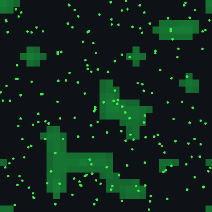

# Devlog 15: Learning brains, and where memory pays

*Phase 8f. Until now, a brain's wiring was fixed at birth: only evolution, across generations, could change it. Brain memory existed, but nothing used it. This phase let animals learn during their lives, remember places and hold things in mind, each as an evolvable gene with an energy cost. The machinery all works. What it showed: memory pays where food lies beyond sensing range, and learning has not yet paid anywhere.*

## What was built

All of it is optional and off by default, so every earlier world plays out exactly as before. Brains-off reference fingerprints did not change; brain-world references were re-recorded twice, because the brain layout grew.

- **Learning during life (the learning gene).**
  - After each thought, connections that were recently active are strengthened when things went better than usual, and weakened when they went worse.
  - "How things went" is the change in energy since the last thought. Energy handed to babies or neighbours counts as kept, so animals do not learn to stop breeding.
  - What is learned is not inherited, and the learning machinery costs energy.
  - A test brain wired the wrong way round learns the right way from reward alone.
- **Senses for learning:**
  - how energy just changed;
  - how surprising that was;
  - the time of year;
  - what the brain did last time.
- **Place memory (a second gene).** An animal remembers up to four good feeding places, each fading over time, and senses which way, and how far, the best one elsewhere is. Each place it can hold costs energy.
- **Working memory (a third gene), built twice.**
  - First, memory cells slowly blended old and new values. That blurred the one-step "echo" brains were using memory for.
  - The second design gives the brain a "hold" switch for each memory cell, so it decides each thought whether to keep or overwrite. The gene sets how many cells it has.
- **Brain layout:** 78 inputs, 11 outputs and 768 connection slots. Worlds saved with any earlier layout still load.
- **Two test worlds:**
  - `learning-test`: food that moves with the seasons;
  - `oasis-test`: food only in oases far apart, so remembering beats sensing.
- **Two small settings:**
  - `barrenBelow`: barren ground between oases;
  - `placeReflex`: founders start out turning toward the place they remember, as they already did toward the smell of plants.

## What emerged

Every result below comes from 8 worlds per setup, run in the cloud and compared seed by seed. About $2 in all.

- **Evolution keeps every ability.** The learning, place memory and working memory genes settle at moderate levels (about 0.2 to 0.5) in every world, despite their cost.
- **Brains adopt the new senses.** The place sense in particular is wired 10 to 17 times as often as chance.
- **Place memory pays where food lies beyond sensing range.** In the oasis world, with founders starting out steering by it, populations were about 65% larger and animals gathered 2.5 to 2.8 times as much food, on every seed.
  - Learning and working memory added nothing on top: place memory alone did as well.
- **Knowing where to go changed the body.** In the oasis world, size and speed came off their lower limits and armor went to its lower limit: travellers evolved bigger, faster bodies.
- **In the grand world, sensing is enough.** Food grows almost everywhere, so place memory gave no measurable advantage. With the starting reflex it was even selected down: a pull toward "somewhere else" mostly drags animals away from food they can already smell.
- **Learning has not paid yet, anywhere.** The sign of learning (older animals gathering more food than younger ones) never appeared. Brains stay tiny (5 to 10 working connections), because every connection costs energy, so there is little for learning to work on.

## What broke, or misled

- **A result that did not replicate.** After the place-memory step, brains in the grand world seemed to use their memory cells at three times chance, the first time ever. When the brain layout changed and the same setup was run again, memory use was back at chance. With many comparisons, a few look important by luck. **Anything we want to claim now gets confirmed on fresh seeds first.**
- **The first working-memory design** undid what little memory use there was, by blurring it. Hence the redesign with hold switches.
- **A measure bug:** the "memory cells per brain" measure counted past the living animals and reported more cells than a brain can have. Only the measure was wrong; it is fixed.
- **A wiring illusion:** brains seemed to wire the new hold switches, but they wired them just as often where the switches did nothing. New connections land on a random output, and 4 of the 11 outputs are now hold switches.

## Also merged: Phase 9 so far

Phase 9 is under way and merged along with this:
- **The cloud runner.** It works from a file describing an experiment, saves progress as it goes, resumes and extends runs exactly, estimates time and cost, and launches, uploads and shuts down an AWS machine on its own. It is checked against the $50 a month cap, and no run starts without a yes.
- **A cloud speed test:** c8g machines are the cheaper choice per unit of work.
- **The start of a full audit of the grand world.**

What the audit has found so far:
- **Harmful mutations:** without repair, they melt the grand world down (9 of 16 worlds died out in a million ticks). 15% repair is now in the preset.
- **Disease was dead:** sick animals starved within 6 ticks, before they could pass anything on. It now spreads, with 14 to 25% of animals sick, without wiping anything out.
- **Overgrazing** halves what the whole world grows. It was softened slightly.
- **Climate drift** was never switched on. It is now, gently.

The audit continues with turning every setting down and up, once the world settles.

## Next

Back to the grand-world audit. Learning brains wait for a world that needs them: bigger or cheaper brains, predictable dangers, or teaching young what their parents learned.
