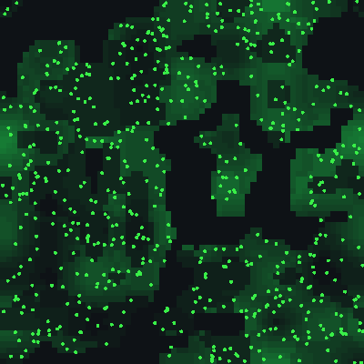

# Devlog 16: Auditing the grand world

*Phase 9, part 1. Before running long experiments, every factor in the grand world was put to the test: each mechanism switched off, each of about 300 settings halved and doubled, each unused feature switched on, and every finding confirmed on fresh seeds before anything changed. It took about 3,200 simulated worlds and about $11 of cloud time. The grand world that came out has about twice the species and a lasting second feeding level, and it is stable over a million ticks.*

## How it was done

- **A cloud runner.**
  - An experiment is a short file: the world, the changes to compare ("arms"), the seeds and the measures.
  - A command estimates the time and cost, and nothing starts without a yes.
  - It then starts one machine on AWS, which runs every world, uploads the results as it goes and shuts itself down. A run that is stopped carries on exactly where it left off.
  - The same seed gives the same history on a laptop and in the cloud.
- **New measures:**
  - where every bit of energy goes (upkeep split into 16 parts);
  - what animals die of;
  - genes stuck at their limits;
  - whether anything is still drifting at the end.
- **A comparison report.** It compares each arm with the control on the same seeds, with a 95% range for each change, and lists red flags decided before the runs: collapses, results too good to be true, big changes, drift, stuck genes.

## What was wrong with the grand world

- **It was slowly melting down.** Harmful mutations piled up with no repair; without it, 9 of 16 worlds died out within a million ticks. A 15% chance of repair fixed it.
- **Disease was dead.** Being sick cost 30 times normal upkeep, so a sick animal starved in about 6 ticks, before it could infect anyone. Each new strain died with its first host. At a cost of 1, with strains that match a wider range of hosts, disease now spreads: 14 to 25% of animals are sick at a time, and nothing is wiped out.
- **Climate drift was never on**, despite being part of the design. Now it is, gently.
- **Overgrazing halved what the whole world grows.** It was softened slightly.
- **14 mechanisms seemed to do nothing.** None was broken. Most were simply too weak in a sparse, overgrazed world:
  - fires that run out of fuel;
  - herds too spread out to protect anyone;
  - colonies too rare for cell types to matter.

## What was added

Each of 23 built-but-unused features was switched on alone. Then the best were confirmed on 16 fresh seeds:
- **nutrients carried through food** (plants on poor soil are poor food);
- **a floor on the mutation rate**, so every baby varies a little;
- **rare big mutations.**

Together they give, over a million ticks:
- about **twice the species** and 90% more diversity;
- **a lasting second feeding level** of mixed eaters, in every world;
- **five times the meat and eight times the kills;**
- **births with two parents up from 18% to 45%;**
- **half the worn ground;**
- the same population, turning over faster.

Some features made the world harder but no richer: climate biomes with drinking, bigger meals, colony savings, toxicity, and the learning-brain features. They stay off.

## What the grand world is sensitive to

Every one of about 300 settings, halved and doubled. Then the shortlist was confirmed on 16 fresh seeds:
- **Climate is the fragile side.** A world at half the base temperature died in 7 of 16 seeds, and ice ages twice as cold killed 5 of 16. Today's values have a margin: 20% colder, or ice ages 50% colder, kill nothing.
- **Poorer plant food builds a food web,** with up to twice the meat and two thirds more kills. The price is half the animals, lives under half as long and a third fewer species.
- **133 of 291 settings change nothing measurable,** mostly the fine details of disasters, colonies, herds and brain chemistry.

## What broke, or misled

- **Four seeds find big effects, and some false ones.** The weather setting looked like a peak for population with 4 seeds and was nothing with 16. From now on, nothing changes without a 16-seed confirmation.
- **A quirk of units:** food is set per food cell, not per area, so making cells smaller multiplies the food.
- **AWS limits this account to 32 cores at once.** The runner now plans within that.
- **Tooling, all fixed:**
  - the status file could be uploaded half-written;
  - a plain download could leave old saved worlds beside newer results;
  - the report ran out of memory on 2,280 runs;
  - one large download failed once.

## Still open

- **No lasting meat-eating group yet.** Individuals reach a pure meat diet, but none founds a group.
- The sex gene sits low, yet nearly half of all births have two parents.
- Switching off kin restraint cuts hunting by three quarters.

## Next

The headline experiments: questions the audited grand world can now answer, each with a chart and a written conclusion.
