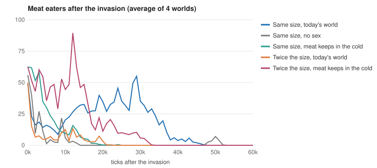

# Devlog 18: The missing meat eaters

*Phase 9, part 3. No headline experiment produced a lasting group of meat eaters, so this was a hunt for the reason: a diagnosis of who earns what, three new settings, a screen of seven changes, and two "invasion" tests that drop ready-made meat eaters into the grand world. About $1 of cloud time. The question stays open, but it is now much narrower. Full write-up: `docs/findings/phase-9-headline-experiments.md`, sections 6 to 6c.*

## What was built

- **A diet ledger** (`apps/runner/scripts/diet-ledger.ts`). It follows every animal in a world and tallies, by diet, how much it earns from plants and from meat, how often it kills, breeds and dies.
- **Three new settings**, all off by default, each with tests:
  - **meat keeps in the cold:** carcasses rot more slowly where it is too cold for plants to grow well;
  - **hungry prey defend less:** a starving animal is easier to catch;
  - **weapons get in the way of grazing:** sharp teeth grind plants poorly, so armed animals take smaller plant bites.
- **Invasions** for experiments. At a chosen tick, every n-th animal gets new genes, as if a ready-made group had arrived. It can also make them bigger, paying for the bigger body from their own energy and nutrient (topped up from the soil where they stand), so nothing is created.

## What we learned

- **The diagnosis.**
  - Almost every kill is made by armed plant eaters.
  - The rare animals that eat mostly meat carry almost no weapons, so they only scavenge, and they die fast.
  - A mixed eater gets most of a carcass's value anyway: carcasses rot slowly, so eating them slowly costs little.
- **No setting made meat eaters evolve** (4-seed screen of seven changes). They split into two groups:
  - Making meat easier to get feeds the mixed eaters, not specialists. Meat keeping in the cold gave six times the mixed eaters and 79% more kills, but fewer species.
  - Making the in-between costly removes the mixed eaters, and nothing takes their place.
- **Ready-made meat eaters can make a living, but never for long.** Dropped into the grand world, they hunt, sometimes double in number, and in one world grew to a tenth of all animals, but were gone within 70,000 ticks of arriving. Every group in every setup still died out. It was not boom and bust, not dilution by mating (no sex did not help), and not their diet drifting back to plants.
- **Bigger meat eaters did worse.** A body twice the size kills more often but needs twice the energy to breed, and the prey stay small.
- **So a meat-eating life here runs at about break-even.** A small group drifts until it hits zero.

## What broke, or misled

- **"Hungry prey defend less" backfired on invaders:** a newly converted meat eater is hungry too, so it became easy prey itself.
- **My first idea, "hunting takes time from grazing", worked out too weak on paper** (6 to 10% of a typical hunter's grazing), so it was replaced by the weapons setting before anything ran.
- **Counting the last meat eater seen overstated survival.** Stray single mutants with a high diet gene appear now and then, so "last seen" ran long; counts over time are what to trust (one survival time was first reported as 90,000 ticks instead of about 40,000).

## Still open

- **No lasting meat eaters.** Two things are untested:
  - hunting behavior (invaders kept their grazers' brains);
  - the basic exchange rate of a kill: a body holds 4 units of energy per unit of size, while making one costs 30.
- The three new settings stay off; none is a clear improvement to the grand world.

## Next

Phase 9's "Done when" items are met. Lasting carnivores join the open questions for later.
