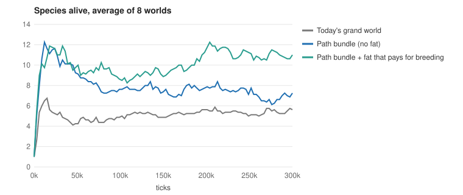

# Devlog 21: A richer grand world

*Phase 9, part 6. A short one. The changes found while hunting for meat eaters (devlog 20) were confirmed on 16 fresh worlds over 500,000 ticks and adopted as the new grand world. About $1 of cloud time.*

## What changed in the grand world

- **Animals never attack their own parent or young** (they used to, because babies are born on their parent's spot and hunters take whoever is nearest).
- **Plants grow faster** (0.24 per food cell per tick, against 0.12).
- **Meat keeps in the cold** (carcasses rot more slowly where it is too cold for plants).
- **Harmful mutations are mended more often** (half of them, against 15%), so the load per animal settles near 6 instead of 16.
- **Heat and cold cost half as much.**
- **A fat reserve that works like fat:**
  - it banks only true surplus;
  - it is drawn on in lean spells;
  - half of it is handed to young;
  - it pays for breeding.

## What it gives (16 seeds, against the classic grand world)

- **About twice the species alive** (first measured as 10.6 against 4.5; the species tracker was still counting the fat gene, and with that fixed the new grand world has about 8.8, devlog 22 / finding 11), more over the run, and about half again the diversity (Shannon 1.67 against 1.12, corrected), and the biggest species holds a third of the animals instead of half.
- **A bigger, steadier population** (+43%, and the lowest point doubled), with fewer deaths by starvation (27% against 47%).
- **A busier food web:** six times the mixed eaters, twice the meat in the diet, three times the kills, 1.95 feeding levels.
- **Evolution keeps the fat** (gene about 0.6).
- **Lives are a little shorter** (-17%, not certain), and sex is unchanged.

## What did not change

- **Still no lasting meat-eating group.** For a world with them, use the Grand world: hunters preset. Next candidates for the last step: mating by diet, gentler seasons, letting would-be hunters perceive prey, a founder pull toward prey.

## Housekeeping

- **The old version is kept as "The grand world, classic"** (`configs/grand-world-classic.json`), and every earlier experiment now names it, so past results re-run exactly.
- **The AWS notes no longer say "spot only"** (the project uses on-demand machines).
