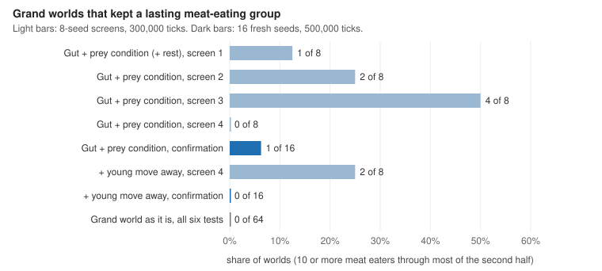

# Devlog 23: Predator life

*Phase 9, part 8. The owner's ideas: real predators digest slowly, rest a lot and take the easiest prey. This round built those, tested them, and then did an autopsy of the short-lived meat-eating groups to see what ends them. Seven cloud experiments, about $7. Full write-up: `docs/findings/phase-9-headline-experiments.md`, findings 12 to 13d.*

## What was built

All of these are off by default, with tests.

- **A gut** (`gutMode`). Food goes into a stomach and turns into energy over time. How fast an animal eats is set by its size, not its metabolism. Plants are bulky and meat is dense, and a full stomach eats nothing. The energy in the stomach is in the books and goes into the carcass. Brains can sense how full they are.
- **Rest** (`restSaving`). An animal that barely moves and eats nothing pays less upkeep. As first built it switched on all at once below a set pace, and it never happened. Now it is graded by how slowly the animal moves.
- **Prey condition** (`preyCondition`). Hungry, sick, old or young animals defend themselves less well.
- **Fighting back** (`fightBack`). An animal's own weapons count toward its defense.
- **Choosing the easiest prey** (`preyChoice`). Hunters go for the weakest prey in reach, not the nearest.
- **Injury** (`attackInjury`). A failed attack costs the attacker energy, more when the prey is well armed compared with the attacker.
- **Young that move away** (`natalDispersal`). A newborn starts a set distance from its parent.
- **Measures:**
  - the diet ledger now records how each diet group dies: ran out of energy, killed by a meat eater, or killed by anyone else;
  - a new kill autopsy (`meatKills`) notes every kill that involves a meat eater: who, how related, how big, the odds, and what else was in reach.

## What we learned

- **The gut with prey condition is the strongest lever on meat eating tried so far.** It doubles the average diet gene and much less starving, but it does not make meat eaters last.
  - In 8-seed screens it kept a lasting meat-eating group in 1, 2, 4 and 0 of 8 grand worlds.
  - On 16 fresh seeds over 500,000 ticks it was 1 of 16, at a cost of about a third of the species and a fifth of the animals.
- **Meat eaters do not starve; other meat eaters kill them.** Five of six meat eaters that are killed die at the hands of another meat eater.
- **Why, from the autopsy:**
  - meat eaters live in clumps of their own kind (about 60% of the animals within their reach are meat eaters);
  - hunters attack the nearest animal they can, and the nearest is usually an equal-sized fellow meat eater, often a relative;
  - meat eaters evolve low tolerance of relatives, and attacking an armed equal costs nothing extra.
- **None of the fixes changed that:**
  - choosing the easiest prey made meat eating rarer;
  - fighting back did nothing clear;
  - injury made meat eaters drop armor and pick fights they win;
  - young moving away cut siblings among the victims, but meat eaters still gather in the same places, and on 16 seeds it kept no group at all.
- **Small prey is not the barrier.** Meat eaters thrive in worlds whose animals are as small or smaller. Compared with the hunters world, in the grand world meat eaters earn the same from meat but pay 57% more to stay alive, and their prey breed at half the rate.

## What broke, or misled

- **Small screens kept over-stating results.** Two setups that looked promising on 8 seeds (4 of 8 worlds, and 2 of 8) came to 1 of 16 and 0 of 16 on fresh seeds over a longer run. Every claim in this round went through a 16-seed confirmation before it was written up as a result.
- **Rest as first built never switched on** (a cliff at one pace). It is now graded.
- **Adding the gut once changed the history of worlds without it.** The order of an addition changed when the gut is off, and the rounding with it. It is now kept in the old order, and the golden fingerprints of older worlds are unchanged.

## Still open

- **Lasting meat eaters in the grand world.** They appear only when the four costly features are off (Grand world: hunters). The clearest remaining levers are how fast prey breed and what meat eaters pay to stay alive.
- **The owner's next idea,** plants that evolve and many more kinds of plant, could change how fast plant eaters breed. A plan comes next.
- **Every predator-life setting stays off.** None improves the grand world on 16 seeds.
