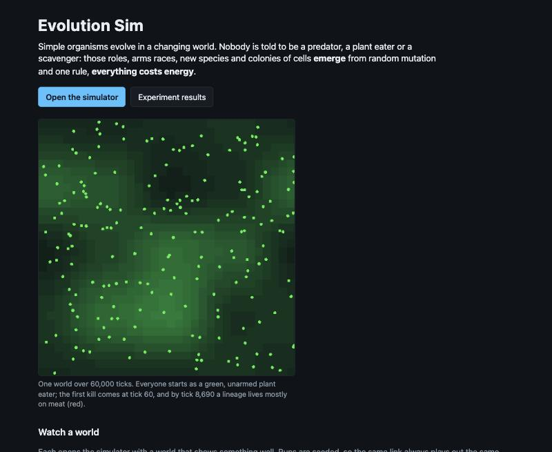

# Devlog 25: Ship it

*Phase 10, and the v1.0 release. The simulation becomes something a visitor can open, understand and share: a front page with six featured worlds, links that replay any run exactly, the findings and the devlog on the site, and a new README. One small cloud run, about $0.40.*

## What was built

- **A front page** at the site's address:
  - what the project is, in two sentences, and a time-lapse;
  - six featured worlds, each starting in one click with a line on what to watch for: the grand world, food webs from nothing, a predator arms race, an ice age, two continents, and living plants.

  The simulator moved to its own page (`app.html`). Links shared before keep working: the front page sends them straight on.
- **The grand world is the default.** It is what the simulator opens with.
- **Shareable links.**
  - A Copy link button.
  - The address holds the seed, the world and any changed settings (`&set=plantEvolution:1`), so any run, not only a preset, can be shared.
  - A test checks that a world started from a link plays out exactly like one built directly.
  - A link whose settings do not fit its world says why and starts the plain preset.
- **What we found:** one page for visitors, covering:
  - what emerges;
  - what the experiments showed;
  - the meat-eater puzzle, told as an open problem;
  - living plants;
  - how we know.
- **The devlog as a series:** an index grouped by phase, generated from the entries (`apps/runner/scripts/devlog-index.mjs`), with two titles tidied.
- **A reading page** that shows the findings and every devlog entry on the site, straight from the repo's markdown. Links between documents stay on the site; images use the site's copies; links to code go to GitHub.
- **A new README:** status, the site's pages, an architecture diagram, the featured worlds, shareable links, running experiments, the repo layout.
- **Version 1.0.0** and release notes (`docs/releases/v1.0.md`).

## Picking the featured seeds

Each featured world was run on 4 candidate seeds for 100,000 ticks in the cloud (`experiments/featured-worlds`). The seed that best shows what its card promises was kept:

| World | Seed | Why |
|---|---|---|
| The grand world | 42 | the biggest, steadiest population and the most mixed eaters (about 290) |
| Food webs from nothing | 12 | the earliest lasting meat eaters (10 or more by tick 38,000) and the most of them later |
| Predator arms race | 42 | meat eaters by tick 7,000, and the highest low point |
| Ice age | 42 | the population halves (438 to 236), the survivors' preferred temperature drops the most (0.51 to 0.40), and it recovers fully |
| Two continents | 12 | the two halves drift apart the most |
| Living plants | 7 | plants fit their land best (correlation 0.72), with 10 species |

**What broke, or misled:** the grand world's card first promised "short-lived meat-eating groups". None of the 4 seeds showed one within 100,000 ticks, so the card now points to the mixed eaters instead.

## Still open

- **Embedding on a portfolio site** waits until there is a site to embed in (GitHub Pages only for now, by the owner's choice).
- **In a narrow window the simulator's side panel runs past the edge,** the first item for the user-interface work that comes next.
- **Lasting meat eaters in the full grand world** stay the main open scientific question.
