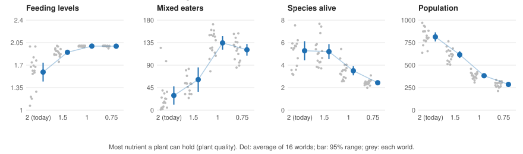
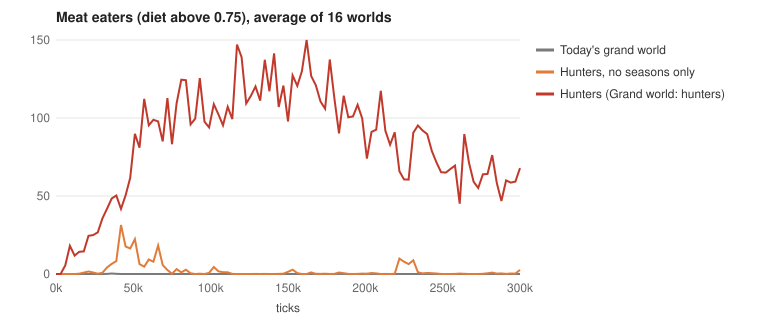
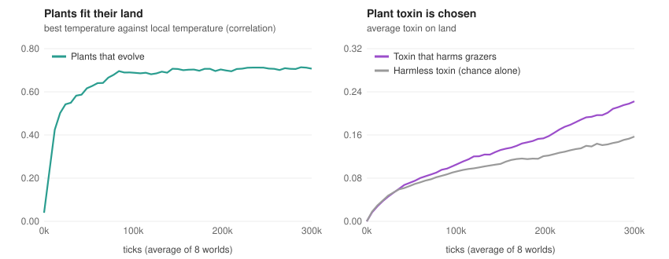

# What we found

Evolution Sim is a deterministic artificial-life world. Every organism starts as the same unarmed plant eater, every trait costs energy, and the same seed always gives the same history, so any result can be replayed and tested on many worlds. This page sums up what came out of it: what emerges on its own, what the experiments showed, and what still does not work. The details are in the [devlog](../devlog/README.md), the working notes ([Phase 9](phase-9-headline-experiments.md), [living plants](living-plants.md), [bigger brains](phase-11-brains.md)) and the experiment results page in the viewer.

## What emerges on its own

Nothing below is programmed in. There is no predator class; whether eating others pays depends on an organism's genes and its surroundings.

- **Food webs.** In the simple world, killing starts within the first 50 ticks and scavenging within a few hundred. A lineage that lives mostly on meat appeared in **12 of 12 worlds** (median tick 29,000). After the first predators arrive, plant eaters crash, and a predator and prey system settles in, with meat-eater numbers swinging in irregular waves.
- **Arms races.** Prey answer hunters with armor and speed, and the race never settles.
- **Species.** Over a million ticks, each of 12 worlds made 23 to 50 species, with three or four alive at any time: a stream of short-lived offshoots from a few lasting groups.
- **A changing world leaves its mark.**
  - Populations split by water drift apart, nine times as far as without the barrier, and each continent grows its own species.
  - An ice age halves the population and leaves survivors that prefer the cold.
- **Ecology.**
  - With disease, plant eaters keep about a third more genetic variety.
  - With camouflage, their colors come to match the ground.
  - With a litter-size gene, the population doubles.
- **Brains.** With evolvable neural networks, prey learn to turn away from threats (0.68 of the time, against 0.52 without brains). Meat eaters learn to ambush: they slow down and let prey walk into reach. They never learned to chase.
- **Colonies.** Colonies of specialized cells can beat single cells. In a sunlit world with little food and no predators, colonies roughly doubled the population in 7 of 12 worlds where they had a head start. They rarely start from nothing, and they lose once predators evolve.

## Experiments at scale

Phase 9 turned the simulation into a tool for questions. Each experiment runs the same seeds under different setups on a cloud machine, then compares them seed by seed. A change counts only when its 95% range excludes no change, and any claim is confirmed on 16 fresh seeds before a preset changes.

- **The grand world was audited.**
  - Every mechanism was switched off, every one of about 300 settings halved and doubled, and every unused feature tried: about 3,200 worlds in all.
  - It turned up a world slowly melting down from harmful mutations with no repair, a disease too deadly to ever spread, and a climate drift that was never on.
  - Fixed, the grand world is stable over a million ticks, with about twice the species and a lasting second feeding level of mixed eaters.
  - Climate is its fragile side: a world at half the temperature died in 7 of 16 seeds.
- **Five headline questions** (16 worlds each):
  - **Sex** does not speed up new feeding levels. It stops them from lasting, because mating blends a would-be meat eater back into the plant-eating majority. Yet it gives 2.4 times the species, because needing a close mate splits the population into breeding groups.
  - **An ice age** leaves no lasting mark on diversity unless it is severe.
  - **Disease** does not stop one species from taking over, but it supports mixed eaters.
  - **Barriers** raise diversity once they really split the land (just adding sea made lakes, not continents).
  - **Poorer plant food** adds most of a feeding level, then, below a point, costs species.

## The meat-eater puzzle

The simple world grows meat eaters every time. The grand world, with everything switched on, never kept a lasting group of them. Finding out why took most of Phase 9.

- **Four features together erase them:** the climate's seasons, harmful mutations, sex and kin restraint. Each hurts a small, sparse group more than a big one, and a meat-eating group always starts small. Take all four out ("Grand world: hunters") and a lasting group of meat eaters forms in 13 of 16 worlds, with 2.7 feeding levels and 29% more species.

- **Many fixes were tried in the full grand world:**
  - sparing family;
  - richer carcasses;
  - a fat reserve that pays;
  - mating by diet;
  - a specializing eye;
  - a slow gut;
  - weak prey that are easier to catch;
  - hunters picking the easiest prey;
  - injury from failed attacks;
  - young that move away.

  The strongest, a slow gut together with weak prey, looked promising on small tests but kept a group in only 1 of 16 worlds on a long confirmation, at a cost of a third of the species.
- **What actually kills them** (an autopsy of every kill):
  - Meat eaters rarely starve; five of six that are killed die at the hands of another meat eater.
  - They live in clumps of their own lineage, and a hunter attacks the nearest animal it can, which is usually an equal-sized fellow meat eater.
  - Small prey is not the problem: meat eaters thrive in worlds whose animals are as small. In the grand world they earn the same from meat but pay more to stay alive, and their prey breed at half the rate.
- **A lesson in method:** 8-world screens repeatedly overstated results that 16 fresh worlds then shrank or erased.

## Living plants

Plants used to be a few fixed kinds. Now they can evolve, become poisonous and carry three nutrients (all optional).

- **Plants fit their land on every seed.** Their preferred temperature comes to follow the local temperature, and three kinds spread into eight or nine distinct chemistries. Animals' palates diversify to match, but species do not rise.
- **Plant toxin is chosen, not only chance.** Harmful toxin ended above a harmless control in all 8 worlds, and grazers avoiding it leave 40% more plants standing.
- **Nutrients matter only when a one-plant diet falls short.** Then lives shorten, plant eaters breed faster and kills rise.
- **None of it makes meat eaters last:** plants that evolve cut meat eating by a fifth to a third.

## How we know

- **Determinism:** the same seed and settings give the same history in any browser, on a laptop or in the cloud. Tests check it.
- **Two ledgers:** energy flows one way (sun, plants, eaters, heat) and balances to better than one part in a billion. Matter goes round in a circle and is never created or destroyed. Tests check both.
- **Many worlds, not one:** every claim here rests on 8 to 16 seeds compared side by side, with the spread shown. The open problems are reported as open.
